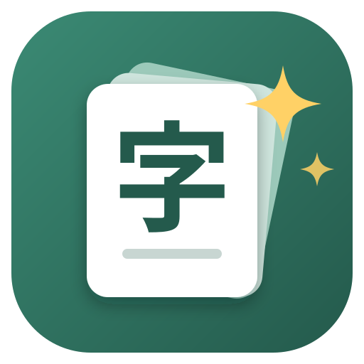

<h1 align="center">Ankiji</h1>

Turn your study material into Anki flashcards with AI, then add real example sentences from anime. A small Windows app that runs on your own computer.

---

## What it does

- **Material in, cards out.** Drop in PDFs, photos, screenshots, Word, PowerPoint or text. Scanned worksheets with vertical Japanese and furigana work too: the AI reads the page image.
- **Your format.** You write the card prompt once (Japanese and Mandarin prompts are built in) and the AI fills the fields of your own Anki note type.
- **No duplicates.** Cards already in your deck are found and skipped before anything is added.
- **Media from Nadeshiko.** One click adds a screenshot, the audio and the Japanese and English subtitles of an anime line that uses the word, preferring anime from your MyAnimeList.
- **Your choice of AI.** An OpenAI API key, or the ChatGPT or Claude subscription you already pay for.
- **Ready-made note types** for Japanese (with on-screen kanji handwriting) and Mandarin, created in Anki with one click.

## Get started

1. Download **Ankiji.zip** from the [latest release](../../releases/latest).
2. Right-click it, choose **Extract All...**, and extract it into your **Documents** folder.
3. Open the **Ankiji** folder and double-click **Ankiji.exe**.
   Windows may say "Windows protected your PC" because the app isn't signed: click **More info**, then **Run anyway**.
4. Open the **Setup guide** tab in the app. It walks you through everything, step by step:
   Anki account, connecting Anki, the note type, choosing an AI, Nadeshiko and iPhone clips.

Close the app window to quit. To update, extract a newer zip over the old folder: your settings are kept.

### What you need

| | |
|---|---|
| Computer | Windows 10 or 11 (the app window uses Microsoft Edge, which Windows already has) |
| Anki | [Anki desktop](https://apps.ankiweb.net) with the AnkiConnect add-on (code `2055492159`) |
| AI, one of | OpenAI API key, or ChatGPT Plus or higher, or Claude Pro or Max |
| Optional | A free [Nadeshiko](https://nadeshiko.co) API key for media, an iPhone with AnkiMobile for clips while studying |

## Privacy

Everything runs on your computer. Your settings and keys are saved in `settings.json` next to `Ankiji.exe` and nowhere else. Your material only goes to the AI you choose, and words you look up only go to Nadeshiko.

## Problems?

| Problem | Fix |
|---|---|
| "Anki not connected" | Open Anki, check the AnkiConnect add-on is installed, restart Anki, then click **Recheck**. |
| An antivirus blocks the .exe | Small unsigned apps are sometimes flagged. Allow the **Ankiji** folder. |
| The AI says "Not installed yet" or "Not signed in yet" | Click the setup guide link next to **Check again**. |

Found a bug or have an idea? [Open an issue](../../issues).

## Contributing

Pull requests are welcome. See [CONTRIBUTING.md](CONTRIBUTING.md) to run it from source, how the code is laid out, and how to build the .exe.

## License

[MIT](LICENSE). The bundled handwriting recognition (KanjiCanvas, with stroke data from KanjiVG) has its own licenses: see [THIRD_PARTY_NOTICES.md](THIRD_PARTY_NOTICES.md).
